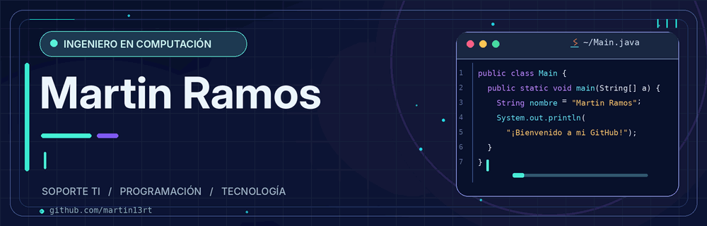

  

# 👋 ¡Hola! Soy Martin Ramos

### 👨‍💻 Ingeniero en Computación | Desarrollo de Software • Automatización • TI

🎓 Ingeniero en Computación por la **UAEMéx**, con un Diplomado Superior en Desarrollo de Software Empresarial.

💻 Actualmente me desempeño como **Ingeniero de Soporte TI**, con experiencia en soporte técnico, infraestructura tecnológica y gestión de servicios.

🚀 Me apasionan la tecnología, la programación y la creación de soluciones que permitan optimizar procesos.

🌱 Continúo ampliando mis conocimientos en **desarrollo de software**, explorando nuevas tecnologías y trabajando en proyectos personales.

---

## 🛠️ Tecnologías y herramientas

  
  
  
  
  
  
  
  
  
  
  
  
  
  
  

**💼 Experiencia profesional:** Jira Service Management · ServiceNow · Microsoft 365 · ITSM · Gestión de SLA

**📚 En aprendizaje:** Programación · C# · Unity · Git y GitHub

*Los iconos incluyen tecnologías, plataformas y ecosistemas de experiencia o interés, sin representar dominio de todos ellos.*

---

## 🚀 Proyectos destacados

### 🛠️ [Implementación de IT Service Desk](https://github.com/martin13rt/IT-Service-Desk-Implementation)

Diseño e implementación de una plataforma de gestión de servicios TI con **Jira Service Management**, incluyendo flujos de trabajo personalizados, SLA, automatizaciones, gestión de incidencias y procesos de escalamiento.

### 🎮 Videojuego 2D de lucha libre

Proyecto personal desarrollado con **Unity y C#**, enfocado en movimiento de personajes, colisiones, físicas y mecánicas de juego.

**Estado:** 🚧 En desarrollo.

---

## 🎯 Objetivo profesional

Continuar creciendo en el **desarrollo de software**, combinando mi experiencia en tecnologías de la información con nuevos conocimientos de programación, desarrollo de aplicaciones y automatización.

---

## 📩 Contacto y redes sociales

  

  

  

---

⭐ Este perfil se actualizará conforme avance en mis proyectos y adquiera nuevos conocimientos.

